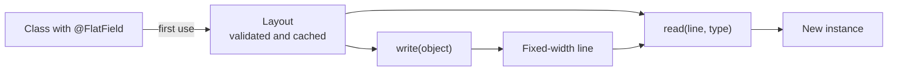

<div align="center">

# flat2java

**Fixed-width flat file records to Java objects and back, driven by one annotation.**

[](https://github.com/allanhladki/flat2java/actions/workflows/ci.yml)
[](https://central.sonatype.com/namespace/io.github.allanhladki.flat2java)
[](LICENSE)


[Quick start](#quick-start) ·
[Record format](#record-format) ·
[Configuration](#configuration) ·
[Modules](#modules) ·
[Changelog](CHANGELOG.md)

</div>

---

flat2java maps Java classes to fixed-width text records, the layout used by COBOL copybooks,
mainframe exports and many bank and government file formats, and reads those records back into
objects. Fields are described with `@FlatField`, and the mapping of each class is validated once:
at first use, or at compile time with the optional annotation processor.

```text
P-0001    20240315000009990
└── id ──┘└─date─┘└─amount┘
 10 chars 8 chars 9 chars
```

## Contents

- [Requirements](#requirements)
- [Installation](#installation)
- [Quick start](#quick-start)
- [How it works](#how-it-works)
- [Record format](#record-format)
  - [Nested records](#nested-records)
  - [Lists and arrays](#lists-and-arrays)
  - [Java records](#java-records)
  - [Field order](#field-order)
- [Configuration](#configuration)
- [Errors](#errors)
- [Limitations](#limitations)
- [Modules](#modules)
- [Building from source](#building-from-source)
- [Contributing](#contributing)
- [License](#license)

## Requirements

| Requirement | Version |
|---|---|
| Java | 17 or later |
| Spring Boot (optional, `flat2java-spring`) | 3.x |
| Quarkus (optional, `flat2java-quarkus`) | 3.x |

`flat2java-core` has one runtime dependency: `slf4j-api`.

## Installation

```xml
<dependency>
    <groupId>io.github.allanhladki.flat2java</groupId>
    <artifactId>flat2java-core</artifactId>
    <version>0.1.0</version>
</dependency>
```

<details>
<summary>Gradle</summary>

```kotlin
dependencies {
    implementation("io.github.allanhladki.flat2java:flat2java-core:0.1.0")
}
```

</details>

> [!TIP]
> Add [`flat2java-processor`](flat2java-processor/README.md) to report mapping errors when the
> code compiles instead of at the first `read` or `write`.

## Quick start

Annotate the fields that make up the record:

```java
public class Payment {
    @FlatField(length = 10)
    private String id;

    @FlatField(length = 8, dateTimeFormat = "yyyyMMdd")
    private LocalDate date;

    @FlatField(length = 9, precision = 2)
    private BigDecimal amount;

    public Payment() {}  // a no-arg constructor is required; it may be private
    // other constructors, getters...
}
```

Write and read records:

```java
Flat2Java flat = Flat2Java.create();

String line = flat.write(payment);            // "P-0001    20240315000009990"
Payment copy = flat.read(line, Payment.class);
int length = flat.recordLength(Payment.class); // 27
```

> [!NOTE]
> `Flat2Java` is immutable and thread-safe. Create one instance per configuration and reuse it:
> the mapping of each class is validated and cached on first use.

<details>
<summary>Reading a file with one record per line</summary>

```java
try (Stream<String> lines = Files.lines(path)) {
    List<Payment> payments = lines.map(line -> flat.read(line, Payment.class)).toList();
}
```

</details>

## How it works



On first use of a class, flat2java reads its annotations, checks the mapping rules, and builds one
codec per field. Later calls reuse that layout, so reflection and validation run once per class
and `Flat2Java` instance.

## Record format

A record is the concatenation of its fields, superclass fields first. Each field occupies exactly
`length` characters.

| Java type | Written as | Example (`length`) |
|---|---|---|
| `String` | Left-aligned, filled on the right with `padding` (default space). | `"ABC"` (6) → `ABC   ` |
| `int`, `Integer`, `long`, `Long`, `BigInteger` | Unsigned digits, zero-filled on the left. | `42` (5) → `00042` |
| `BigDecimal` | Unsigned digits with `precision` implied decimal places, zero-filled on the left. | `12.34`, precision 2 (7) → `0001234` |
| `BigDecimal` with `useDecimalSeparator` | Same, with an explicit separator. | `12.34`, precision 2 (7) → `0012.34` |
| `LocalDate`, `LocalDateTime` | Formatted with `dateTimeFormat`. | `2024-03-15`, `yyyyMMdd` (8) → `20240315` |
| A class or record with `@FlatField` fields | Its own record, inlined. | [Nested records](#nested-records) |
| `List<T>` or `T[]` of the types above, with `occurs` | `occurs` elements of `length` characters each. | [Lists and arrays](#lists-and-arrays) |

<details>
<summary><code>@FlatField</code> attributes</summary>

| Attribute | Default | Applies to | Meaning |
|---|---|---|---|
| `length` | required | all | Width in characters. For a list or array, the width of one element. |
| `position` | `0` (unset) | all | One-based position in the record. See [Field order](#field-order). |
| `precision` | `0` | `BigDecimal` | Number of decimal places. Smaller than `length`. |
| `dateTimeFormat` | none | `LocalDate`, `LocalDateTime` | `DateTimeFormatter` pattern. Required on those types. |
| `padding` | space | `String` | Fill character on the right. |
| `occurs` | `0` | `List`, arrays | Number of elements. Required on those types. |

</details>

Rules applied to every value:

- Numbers are never truncated. A value that needs more digits than `length`, or a negative value,
  fails.
- A `String` longer than its column is truncated, with a warning in the log, unless
  `failOnStringTruncation` is enabled. Then it fails. Truncation never splits a character made of
  two UTF-16 units, such as an emoji: the whole character is dropped and the column is padded.
- `BigDecimal` values with more decimal places than `precision` fail unless a `roundingMode` other
  than `UNNECESSARY` is configured. With `useDecimalSeparator`, `length` must be at least
  `precision + 2` (one integer digit and the separator); this is checked when the layout is built.
- Date patterns must have a fixed width (`dd`, not `d`) and keep the century: `yy` is rejected,
  because `990501` would be read back as 2099. Parsing is strict: `20240231` is rejected, not
  adjusted to February 29. Patterns use `Locale.ROOT`. `yyyy` and `uuuu` are both accepted.
- Reading checks every column: numeric columns must contain digits only, so signs and spaces are
  errors.

### Nested records

A field whose type is a concrete class with `@FlatField` fields is written inline. Its `length`
must equal the sum of the nested fields' lengths, so the total record length is visible where the
field is declared.

```java
public class Address {
    @FlatField(length = 20) private String street;
    @FlatField(length = 2)  private String state;
}

public class Customer {
    @FlatField(length = 6)  private int id;
    @FlatField(length = 22) private Address address;  // 20 + 2
}
// "000042Rua das Flores 100  PR"
```

> [!IMPORTANT]
> Fields declared as `Object`, an interface, an abstract class or a type variable are rejected,
> because the class to instantiate when reading would be unknown. A nested record cannot be `null`
> and cannot contain itself, directly or indirectly.

Fields without `@FlatField` are not part of the record: they are ignored when writing and keep
their default value when reading.

### Lists and arrays

A `List` or array field repeats one element type a fixed number of times, like a COBOL `OCCURS`
clause. `length` is the width of one element and `occurs` the number of elements, so the field
takes `length * occurs` characters. `precision`, `dateTimeFormat` and `padding` apply to each
element.

```java
public class Invoice {
    @FlatField(length = 4)              private int id;
    @FlatField(length = 3, occurs = 3)  private int[] counts;
    @FlatField(length = 5, occurs = 2)  private List<Item> items;   // Item fields: 3 + 2
}
// "0012" + "001020300" + "X1 05Y2210"
```

| Allowed | Rejected |
|---|---|
| `List<T>` and `T[]`, including primitive arrays such as `int[]` | Other collection types, raw `List`, wildcards such as `List<? extends T>` |
| Elements of any supported type, including nested records | Elements that are themselves lists or arrays |
| Exactly `occurs` elements when written | A variable count (COBOL `OCCURS DEPENDING ON`) |

A list is read as a mutable `ArrayList`.

> [!NOTE]
> `Map` fields are not supported: a map has no defined order and no fixed layout for its keys.
> Use a list of a nested record with a key and a value field instead.

### Java records

Annotate the record components. Records are read through their canonical constructor, so they
need no no-arg constructor, and the components keep the order of the record declaration, which
the Java specification guarantees.

```java
public record Point(@FlatField(length = 4) int x, @FlatField(length = 4) int y) {}

flat.write(new Point(12, 7));  // "00120007"
```

Components without `@FlatField` receive `null`, `0` or `false` when a record is read. Records can
be nested in classes and classes in records.

### Field order

By default fields follow declaration order, superclass first. To set the order explicitly, set
`position` on every field:

```java
public class Header {
    @FlatField(position = 1, length = 2) private String type;
    @FlatField(position = 3, length = 8, dateTimeFormat = "yyyyMMdd") private LocalDate created;
    @FlatField(position = 2, length = 5) private int sequence;
}
// type, sequence, created: "HD0000120240315"
```

Positions are all-or-nothing across a class hierarchy, must be unique, and must be contiguous from 1.
A nested record's positions are independent from the enclosing class.

> [!WARNING]
> For classes, declaration order is what `Class.getDeclaredFields()` returns. It matches the source
> on mainstream JVMs, but the Java specification does not guarantee it. Set `position` when the
> layout must not depend on it. The component order of a record is guaranteed.

## Configuration

```java
Flat2JavaOptions options = Flat2JavaOptions.builder()
        .useDecimalSeparator(true)
        .decimalSeparator(',')
        .roundingMode(RoundingMode.HALF_UP)
        .build();
Flat2Java flat = Flat2Java.create(options);
```

The same settings can be read from environment variables with `Flat2JavaOptions.fromEnvironment()`.
Invalid values fail. The [Spring](flat2java-spring/README.md) and
[Quarkus](flat2java-quarkus/README.md) modules read them from the application configuration.

| Option | Environment variable | Spring / Quarkus property | Default |
|---|---|---|---|
| `allowNullStrings` | `FLAT2JAVA_ALLOW_NULL_STRINGS` | `flat2java.allow-null-strings` | `true` |
| `nullValuePadding` | `FLAT2JAVA_NULL_VALUE_PADDING` | `flat2java.null-value-padding` | space |
| `failOnStringTruncation` | `FLAT2JAVA_FAIL_ON_STRING_TRUNCATION` | `flat2java.fail-on-string-truncation` | `false` |
| `useDecimalSeparator` | `FLAT2JAVA_DECIMAL_USE_SEPARATOR` | `flat2java.decimal.use-separator` | `false` |
| `decimalSeparator` | `FLAT2JAVA_DECIMAL_SEPARATOR` | `flat2java.decimal.separator` | `.` |
| `roundingMode` | `FLAT2JAVA_DECIMAL_ROUNDING_MODE` | `flat2java.decimal.rounding-mode` | `UNNECESSARY` |

- `allowNullStrings`: when `true`, a `null` `String` is written as an empty column. Fields of other
  types never accept `null`.
- `nullValuePadding`: fills the column of a `null` `String` whose `padding` is the default space.
  A column made entirely of this character reads back as `""`.

## Errors

All exceptions extend `Flat2JavaException`, an unchecked exception:

| Exception | Thrown when |
|---|---|
| `MappingException` | A class has invalid `@FlatField` declarations: unsupported type, `precision` not smaller than `length`, a date pattern whose width differs from `length`, inconsistent positions, a missing no-arg constructor, and so on. |
| `SerializationException` | A value cannot be written: `null` on a non-`String` field, a negative number, a number wider than its column, a list whose size differs from `occurs`. |
| `DeserializationException` | A record cannot be read: wrong record length, non-digits in a numeric column, an invalid date. The message gives the field and its column range. |

```text
DeserializationException: Payment.amount (columns 19-27): expected digits only
```

> [!NOTE]
> Messages name the field as `Class.field` and never include field values, so they can be logged
> without exposing the record's data.

## Limitations

- Numbers are unsigned. There is no sign position or overpunch encoding.
- `null` is supported only for `String` fields, and reads back as `""`.
- Trailing padding characters are removed when a `String` is read. A value that ends with its own
  padding character does not survive a round trip.
- Records are read and written one line at a time. Records of different types in one file are not
  supported.
- Lists and arrays have a fixed number of elements. `Map` fields are not supported.
- Mapped classes need a no-arg constructor, which may be private. Inner classes must be `static`.
  Java records use their canonical constructor.

## Modules

| Artifact | Purpose | Docs |
|---|---|---|
| `flat2java-core` | The library. | This page |
| `flat2java-processor` | Optional annotation processor that reports invalid mappings at compile time. | [README](flat2java-processor/README.md) |
| `flat2java-spring` | Spring Boot 3 auto-configuration of a `Flat2Java` bean. | [README](flat2java-spring/README.md) |
| `flat2java-quarkus` | CDI producer of a `Flat2Java` bean for Quarkus. | [README](flat2java-quarkus/README.md) |

Classes in the `io.github.allanhladki.flat2java.internal` package are not part of the API and may
change in any release.

## Building from source

```bash
git clone https://github.com/allanhladki/flat2java.git
cd flat2java
mvn verify
```

| Command | What it does |
|---|---|
| `mvn verify` | Tests of all modules, Spotless format check, JaCoCo coverage report |
| `mvn spotless:apply` | Formats the code (google-java-format, AOSP style) |
| `mvn -Prelease -Dgpg.skip verify` | Also builds the sources and Javadoc jars, as a release does |

Changes are listed in [CHANGELOG.md](CHANGELOG.md).

## Contributing

Bug reports and pull requests are welcome. See [CONTRIBUTING.md](CONTRIBUTING.md) for the
development workflow, and [SECURITY.md](SECURITY.md) to report a vulnerability privately.

## License

flat2java is released under the [MIT License](LICENSE).
